# 3. Build Time and Run Time

**Question:** When does the work done by `otel go build` affect a request?

## Two different moments

You write `.go` text files; the computer runs the executable produced by the build.

```bash
# Plain Go: build, then start
go build -o demo .
./demo

# With otel: let the tool join the build, then start the output
otel go build -o demo .
./demo
```

- **Build time**: source code is checked, compiled and linked into an executable. This is where `otel` works.
- **Run time**: the generated program starts and handles real requests. This is where the observation actions execute.

`otel` doesn't change code while the program runs. It adds observation code at build time, and what runs afterwards is **a program that already contains the observation code**.



## What otel does during the build

The [Hacking Guide overview](../hacking/overview.md) describes two extra phases involved in the build:

1. **Preprocess**: analyze the project's dependencies, select the rules to apply, and prepare the dependencies those rules need.
2. **Instrument**: generate code from the rules and add it to the source passed to the compiler.

At the end of preprocessing, the tool runs `go build` with Go's built-in `-toolexec` flag. Each compiler invocation is routed back to `otel`, which performs the instrument phase before running the real compiler. Instrumentation therefore happens inside those tool invocations, rather than as a separate pass between preprocessing and the build.

## First decide which moment the problem belongs to

| Symptom | Happens at | Check first |
| --- | --- | --- |
| Package not found, compile errors | Build time | Dependencies and rules, see [Debugging](../hacking/debug.md) |
| Program runs but no telemetry appears | Run time | Whether rules matched and data is exported, see [OpenTelemetry Settings](../user/sdk-config.md) |

> [!NOTE]
> Because dependencies must be prepared and a full rebuild is forced by default, builds are slower with `otel`. The `-gocache` option allows reuse of the build cache. See [Compilation Time](../user/compilation-time.md).

Next: [Rules and Hooks](./rules-and-hooks.md)
