# 5. Why Add Dependencies

**Question:** It's just one more observation call. Why does the build need to prepare dependencies?

## Try it by hand

Suppose project `demo` builds fine:

```go
package main

import "fmt"

func FindRoom(id int) string {
    return "room-42"
}

func main() { fmt.Println(FindRoom(42)) }
```

Now add one call inside `FindRoom`, using another module `example.com/observer` that lives outside the `demo` directory (its `Record` function just prints `observed: <name>`):

```go
package main

import (
	"fmt"
	"example.com/observer"
)

func FindRoom(id int) string {
	observer.Record("FindRoom")
	return "room-42"
}

func main() { fmt.Println(FindRoom(42)) }
```

Building again fails:

```text
$ go build .
main.go:5:2: no required module provides package example.com/observer; to add it:
	go get example.com/observer
```

The `go.mod` of `demo` doesn't declare this dependency, so Go doesn't know where to find the `observer` code. The build only succeeds after adding the declaration to the same `go.mod`:

```text
module example.com/demo

go <go-version>

require example.com/observer v0.0.0

replace example.com/observer => ../observer
```

Keep the `go` directive generated by `go mod init`; `<go-version>` is a placeholder here, not a literal value.

`require` declares that the module is needed; in this example, `replace` tells Go the source is in the sibling `../observer` directory. Now the build succeeds. Note that `go build` only compiles; `Record` runs when you run the generated program:

```text
$ go build -o demo . && ./demo
observed: FindRoom
room-42
```

The original return value is unchanged; there's just one extra observation record.



## Back to otel

The hook code that `otel` adds automatically also uses libraries of its own, such as the OpenTelemetry SDK and the plugin code. So besides adding calls, the tool must make that code available to the build. That is what "prepare the dependencies the rules need" means in the [Preprocess Phase](../hacking/preprocess.md).

> [!NOTE]
> Newly added code may use other libraries, which may in turn match more rules, so preparing dependencies isn't necessarily a single step. This is one reason builds are slower with `otel`. See [Compilation Time](../user/compilation-time.md).

Next: [Traces and Spans](./traces-and-spans.md)
