# 2. Packages, Modules and go.mod

**Question:** What do `package`, `import` and `module` each do? Where does Go look for the code to compile?

An instrumentation tool adds new code to your program and also brings in new dependencies. Understanding this step makes it clear later why the tool changes dependencies.

## One module, two packages

```text
demo/
├── go.mod         # module example.com/demo
├── main.go        # package main
└── room/
    └── find.go    # package room
```

```go
package main

import "example.com/demo/room"

func main() {
    println(room.Find(42))
}
```

- **package**: a set of source files compiled together, usually one directory. Every function you call belongs to a package.
- **import**: declares which package the current file uses. Standard library packages such as `fmt` and `net/http` are imported the same way.
- **module**: a set of packages plus the versions of their dependencies, declared by `go.mod`.

An `import` path is the package's full path, not "the folder next to me". From `module example.com/demo` in `go.mod`, Go knows that this prefix maps to the `demo/` directory containing `go.mod`. Removing the prefix from the full path leaves `room`, so Go finds `demo/room/`.



## Three lines of go.mod

```text
module example.com/demo

go <go-version>

require example.com/observer v1.0.0
```

This is an illustrative fragment: `<go-version>` stands for the Go version written by `go mod init`, not text to copy literally. For instrumentation, choose a supported version from [Compatibility](../user/compatibility.md).

| Line | Meaning |
| --- | --- |
| `module` | The path of the current module |
| `go` | The minimum Go version needed to build this module |
| `require` | An external module and its version requirement |

`require` only declares a version requirement. It is not a function call, and it doesn't add any behavior to your functions. **`go.mod` only helps Go find code; what the code does is decided by the calls.**



Further reading: [How to Write Go Code](https://go.dev/doc/code)

Next: [Build Time and Run Time](./build-and-run.md)
