# 4. Rules and Hooks

**Question:** Without writing timers by hand, how does the tool know what to change and what to add?

The tool splits the job into two parts:

- **Rule**: tells the tool "what to find": which package, which function, which versions. Rules are written in JSON.
- **Hook**: tells the tool "what to do once found". It is an ordinary Go function, called when the target function is entered (OnEnter) or returns (OnExit).

## A rule

```json
{
  "ImportPath": "net/http",
  "Function": "RoundTrip",
  "ReceiverType": "\\*Transport",
  "OnEnter": "myOnEnter",
  "OnExit": "myOnExit",
  "Path": "./rules"
}
```

Read it as: in package `net/http`, find the `RoundTrip` method whose receiver is `*Transport`; call `myOnEnter` on entry and `myOnExit` on return; the code of these two functions is in the `./rules` directory.

Here, `Function` names the exact method, `RoundTrip`. `ReceiverType` is a regular expression: write the literal `*` as `\*`, which becomes `\\*` after escaping inside a JSON string. See [Hook Rule Types](../dev/rule_def.md) for all fields.

## Execution path before and after

```text
Before                        After
call RoundTrip                call RoundTrip
  → run original body           → run OnEnter hook
  → return result               → run original body
                                → run OnExit hook
                                → return result
```

The original body is unchanged; there are just two extra calls around it. In the real implementation, the tool inserts a small jump at the entry of the original function, which goes through a generated function (the trampoline) before calling the hook. See [Instrument Phase](../hacking/instrument.md).

This diagram shows an observation-only hook. Hooks can also change execution: calling `CallContext.SetSkipCall(true)` in an OnEnter hook skips the original function body.



## Who does what

| Part | What it is | Provided by |
| --- | --- | --- |
| Rule | JSON: which function to find | Built into the tool, or yours via `-rule` |
| Hook | Go function: the extra action | Built into the tool, or written by you |
| Wiring | Adding hook calls around the target | Done automatically by `otel` at build time |

`otel` already ships rules and hooks for many common libraries, see [Supported Libraries](../user/supported-libraries.md). You only need to write your own when the library you want to observe isn't listed, see the [Developer Guide](../dev/overview.md).

Next: [Why Add Dependencies](./dependencies.md)
