# 6. Traces and Spans

**Question:** How can you tell that several records belong to the same request, and who called whom?

After a request enters a service, it may look up a room and then query a database. A single timing record describes one action. We also want to know that these actions belong to the same request and which one called which.

## Reading a call tree

```text
HTTP request        Trace=A  Span=01
└── find room       Trace=A  Span=02  Parent=01
    └── DB query    Trace=A  Span=03  Parent=02
```

- **Trace / Trace ID**: all records related to one request, and the ID identifying them. All three records have `Trace=A`, so they belong to the same request.
- **Span / Span ID**: one operation in the trace, with a start and end time and its own ID.
- **Parent span**: the operation that directly caused the current one. `Parent=02` means "find room" called the database.

The same Trace ID alone doesn't give you the call order; you follow the parents to rebuild the call relationships. (`A`, `01` and so on are simplified for reading; real IDs are random hexadecimal strings.)



## Where the parent comes from

In OpenTelemetry Go, the parent span is stored in a `context.Context` that is passed down through function calls. A new span finds its parent in the context it receives:

```go
_, span := tracer.Start(r.Context(), "db init")
defer span.End()
```

If some step passes `context.Background()`, the explicit context chain is broken. `otel` stores spans in goroutine-local storage (GLS) as a fallback, so many cases still connect, but passing the real `ctx` is the reliable way. See [Context Propagation](../user/context-propagation.md).

## Read next

- [Manual Instrumentation](../user/manual-instrument.md): add your own spans under the automatically created ones.
- [OpenTelemetry Settings](../user/sdk-config.md): set the service name, exporters and sampling. While experimenting, `OTEL_TRACES_EXPORTER=console` prints spans to the terminal.

Next: [Hands-on: Your First Custom Hook](./first-hook.md)
