# 1. Why Instrument

**Question:** If a function already returns correctly, why do we need "instrumentation"?

Start with an ordinary function. It looks up a room by ID and returns the room name:

```go
func FindRoom(id int) string {
    return "room-42"
}

room := FindRoom(42)
```

Getting a return value means the feature works. But the return value alone doesn't tell you how long the call took, whether it failed, or where it got stuck. That is exactly what you need when investigating slow or failed requests.

The most direct approach is to record the time before and after the call, then print the duration:

```go
start := time.Now()
room := FindRoom(42)
fmt.Println("FindRoom took", time.Since(start))
```

`FindRoom` still looks up the room. The new lines only record how it ran.



## Terms

- **Observability**: collecting information about a running program to answer "where is it slow, where does it fail".
- **Instrumentation**: adding observation actions at certain points in a program. The term itself doesn't say whether they are written by hand or generated by a tool.

## The problem with doing it by hand

A few lines in one function are fine. But a service may contain hundreds of HTTP, database and message-queue calls. Writing them all by hand takes time, misses some calls, and mixes observation code into business code.

This is what the `otel` tool solves: **without changing your source code, it adds these observation actions at build time.** The following pages explain how.

> [!TIP]
> Keep the goal in mind: we are observing an **existing** program. You don't need to know any internal functions of the tool yet.

Next: [Packages, Modules and go.mod](./modules.md)
