# 2. 包、模块与 go.mod

**本页问题：** `package`、`import`、`module` 分别管什么？Go 去哪里找要编译的代码？

插桩工具会往你的程序里加入新代码，也会引入新的依赖。读懂这一步，后面才能理解工具为什么要修改依赖。

## 一个模块，两个包

```text
demo/
├── go.mod         # module example.com/demo
├── main.go        # package main
└── room/
    └── find.go    # package room
```

```go
package main

import "example.com/demo/room"

func main() {
    println(room.Find(42))
}
```

- **package（包）**：一起编译的一组源文件，通常对应一个目录。你调用的每个函数都属于某个包。
- **import（导入）**：声明当前文件要使用哪个包。标准库的 `fmt`、`net/http` 也要这样导入。
- **module（模块）**：一组包和它们依赖的版本，由 `go.mod` 声明。

`import` 写的是包的完整路径，而不是“旁边的文件夹”。Go 从 `go.mod` 里的 `module example.com/demo` 得知，这个前缀对应 `go.mod` 所在的 `demo/` 目录；完整路径去掉前缀后剩下 `room`，于是找到 `demo/room/`。



## go.mod 的三行

```text
module example.com/demo

go <go-version>

require example.com/observer v1.0.0
```

这是一段示意内容：`<go-version>` 代表 `go mod init` 写入的 Go 版本，不要原样复制。使用插桩时，请按[兼容性](../user/compatibility.md)选择支持的版本。

| 行 | 含义 |
| --- | --- |
| `module` | 当前模块的路径 |
| `go` | 构建这个模块需要的最低 Go 版本 |
| `require` | 需要的外部模块及其版本要求 |

`require` 只是声明版本要求，不是函数调用，也不会自动给你的函数增加任何动作。**`go.mod` 只负责找到代码；代码怎样执行，由调用决定。**



延伸阅读：[Go 官方：How to Write Go Code](https://go.dev/doc/code)

下一步：[构建时与运行时](./build-and-run.md)
