# 4. 规则与 hook

**本页问题：** 不逐个手写计时，工具怎么知道改哪里、加什么？

工具把这件事拆成两部分：

- **规则（rule）**：告诉工具“找谁”，即哪个包、哪个函数、适用哪些版本。规则写在 JSON 文件里。
- **hook（钩子）**：告诉工具“找到以后做什么”。它是普通的 Go 函数，在目标函数进入时（OnEnter）或返回时（OnExit）被调用。

## 一条规则

```json
{
  "ImportPath": "net/http",
  "Function": "RoundTrip",
  "ReceiverType": "\\*Transport",
  "OnEnter": "myOnEnter",
  "OnExit": "myOnExit",
  "Path": "./rules"
}
```

读作：在 `net/http` 包里找到接收者为 `*Transport` 的 `RoundTrip` 方法；进入时调用 `myOnEnter`，返回时调用 `myOnExit`；这两个函数的代码在 `./rules` 目录。

本例中，`Function` 写确切的方法名 `RoundTrip`。`ReceiverType` 使用正则表达式：要匹配字面量 `*`，写成 `\*`，在 JSON 字符串里再转义一次就是 `\\*`。全部字段见 [Hook 规则类型](../dev/rule_def.md)。

## 插桩前后的执行路径

```text
插桩前                        插桩后
调用 RoundTrip                调用 RoundTrip
  → 执行原函数体                → 执行 OnEnter hook
  → 返回结果                    → 执行原函数体
                                → 执行 OnExit hook
                                → 返回结果
```

原函数体不变，只是在前后多了两次调用。真实实现中，工具会在原函数入口插入一小段跳转代码，经过一个生成的中间函数（trampoline）再调用 hook，详见[埋点阶段](../hacking/instrument.md)。

上图展示的是只做观察的 hook。hook 也可以改变执行过程：在 OnEnter hook 中调用 `CallContext.SetSkipCall(true)` 就能跳过原函数体。



## 记住分工

| 组成 | 是什么 | 由谁提供 |
| --- | --- | --- |
| 规则 | JSON：找哪个函数 | 工具自带，或你用 `-rule` 指定 |
| hook | Go 函数：额外执行的动作 | 工具自带，或你自己编写 |
| 接入 | 把 hook 调用加到目标函数前后 | `otel` 在构建时自动完成 |

`otel` 已经为大量常用库提供了规则和 hook，见[支持的库](../user/supported-libraries.md)。只有你要观察的库不在列表中时，才需要自己写，见[开发者指南](../dev/overview.md)。

下一步：[为什么要补依赖](./dependencies.md)
