# 6. Trace 与 Span

**本页问题：** 怎样判断几条记录属于同一次请求，又是谁调用了谁？

一次请求进入服务后，可能先查房间，再查数据库。单独一条耗时记录只能说明一个动作；我们还想知道这些动作属于同一次请求，以及谁调用了谁。

## 读一棵调用树

```text
HTTP 请求          Trace=A  Span=01
└── 查房间         Trace=A  Span=02  Parent=01
    └── 数据库查询  Trace=A  Span=03  Parent=02
```

- **Trace / Trace ID**：一次请求相关的全部记录，以及标识它们的 ID。三条记录都是 `Trace=A`，说明属于同一次请求。
- **Span / Span ID**：Trace 中的一个操作，有开始和结束时间，也有自己的 ID。
- **父 Span（Parent）**：直接引发当前操作的上一层操作。`Parent=02` 说明是“查房间”调用了数据库。

只看相同的 Trace ID，无法知道调用顺序；要沿着 Parent 才能还原调用关系。（`A`、`01` 等是便于阅读的简化编号，真实 ID 是随机生成的十六进制字符串。）



## 父 Span 从哪里来

在 OpenTelemetry Go 中，父 Span 保存在 `context.Context` 里，并随函数调用传递下去。新的 Span 从传入的 context 中找到父节点：

```go
_, span := tracer.Start(r.Context(), "db init")
defer span.End()
```

如果某一步传了 `context.Background()`，显式传递的 context 链就会断开。`otel` 会把 Span 保存在协程本地存储（GLS）中作为补救，因此很多场景仍能连接链路，但传递真实的 `ctx` 才是可靠的做法，详见[上下文传播](../user/context-propagation.md)。

## 接下来读

- [手动埋点](../user/manual-instrument.md)：在自动生成的 Span 下加入自己的 Span。
- [OpenTelemetry 配置](../user/sdk-config.md)：设置服务名、导出器和采样。试验时可以用 `OTEL_TRACES_EXPORTER=console` 把 Span 打印到终端。

下一步：[动手：第一个自定义 hook](./first-hook.md)
