# 1. 为什么要插桩

**本页问题：** 函数能正常返回，为什么还需要“插桩”？

先看一个普通函数。它根据编号查询房间，并返回房间名：

```go
func FindRoom(id int) string {
    return "room-42"
}

room := FindRoom(42)
```

拿到返回值，说明功能成功了。但只看返回值，你不知道这次调用花了多久、是否出错、卡在哪一步。排查慢请求或失败请求时，需要的正是这些信息。

最直接的办法是在调用前后各记一次时间，再打印耗时：

```go
start := time.Now()
room := FindRoom(42)
fmt.Println("FindRoom took", time.Since(start))
```

`FindRoom` 仍然负责查房间，新增的代码只负责记录它是怎样执行的。



## 名词

- **可观测性（observability）**：收集程序运行时的信息，用来回答“慢在哪里、错在哪里”。
- **插桩 / 埋点（instrumentation）**：在程序的某些位置加入观察动作。这个词本身不区分手写还是工具生成。

## 手写的问题

一个函数手写几行没问题。但一个服务里有成百上千个 HTTP、数据库、消息队列调用，逐个手写既费时，也容易遗漏，还会把观察代码和业务代码混在一起。

`otel` 工具要解决的就是这件事：**业务源码不用改，在构建时自动加上这些观察动作。** 后面几页会解释它是怎样做到的。

> [!TIP]
> 记住目的：我们是在观察一个**已有的**程序。暂时不需要了解任何工具内部函数。

下一步：[包、模块与 go.mod](./modules.md)
